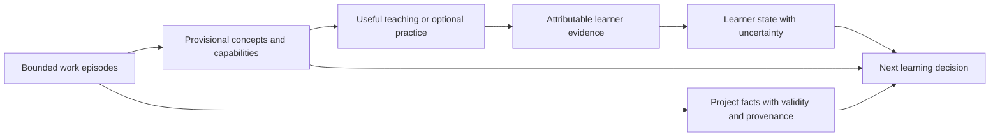

# Learning from ongoing work: concept discovery, graphs and learner state

Research synthesis for LearningHarness, November 19, 2026. Branch: `codex/autokg`.

## Recommendation

Build a local, evolving graph of learnable capabilities grounded in work episodes, with a separate learner-evidence overlay. Use the graph to connect situations and choose useful teaching. Estimate capability from attributable learner responses under recorded conditions. Preserve uncertainty, assistance, scope and time.

This is feasible as an exploration. The literature supports individual pieces, especially knowledge-component discovery, temporal memory and knowledge tracing. It does not establish that combining them will improve learning in agent-assisted professional work. That is the experiment LH needs to run.

The most important design decision is the unit being tracked. Prefer “reason about whether a retry can repeat a side effect” to a broad topic such as “distributed systems” or an entity such as “Stripe.” A concept becomes useful for learner modeling when we can describe what a person should be able to explain, predict, diagnose or apply, and what observation would support that claim.

## Scope and research method

This is a targeted primary-source review, not an exhaustive systematic review or a reproduction of published results. It covers automatic concept discovery, graph construction and identity, temporal memory, learner modeling, assessment design and practical evaluation. Sources span foundational tutoring work through November 2026 preprints. Later studies are marked as preprints where publication was not established.

The closest programming and deployment studies were read beyond their abstracts, including methods, results and limitations. For additional context, some sources were reviewed at the abstract, publisher-summary or repository-documentation level; those are identified below. Papers, code repositories and product documentation support different kinds of claims. None of their benchmark results are LH results. No model training, paid model run or personal-data experiment was performed for this review.

The exact OpenAI research originally mentioned remains unidentified. The verified OpenAI contribution relevant here is the July 2025 temporal-graph cookbook with OpenAI and partner authors. Using OpenAI models in another lab's research does not make it OpenAI research.

## 1. The research most relevant to LH

### 1.1 Discover learnable components, rather than just entities

**KCGen-KT, Duan et al., 2025, preprint.** The researchers generate knowledge components from programming problems and solution ASTs, consolidate equivalent descriptions, and use them in a trained learner model. Their CodeWorkout evaluation contains 246 students, 50 introductory Java problems and 10,834 first submissions. Generated components obtain correctness-prediction AUC 0.821 versus 0.810 with human-written components in the same framework. Human tagging evaluation covers ten problems and two author-annotators; model-to-human F1 is 0.783. The paper explicitly notes that whole-problem correctness cannot reliably attribute errors to individual components. Read: methods, quantitative results, human evaluation and limitations. [Paper](https://arxiv.org/html/2502.18632v1).

**Implication for LH:** capability descriptions and identity consolidation deserve early experiments. Do not import the paper's mastery percentages or assume its trained model transfers to professional work. Our observations contain agent output, multiple projects, sparse voluntary practice and changing tasks.

**Pattern-based KC extraction, Hoq et al., 2025, preprint.** This study extracts and clusters structural patterns from student-code ASTs and tests them through learning curves and knowledge tracing. It reports all-assignment AUC 74.77% versus 65.87% for its DKT baseline. Its limitations include short Java CS1 submissions and exclusion of code that cannot be parsed. Read: representation method, split procedure, results and limitations. [Paper](https://arxiv.org/html/2508.09281v1).

**Implication for LH:** code structure can anchor candidate concepts, but syntax alone will miss engineering decisions. Treat AST signals as optional supporting evidence alongside task goals, captured implementation, tests and explanations. Do not discard a meaningful episode because code is incomplete or unparsable.

### 1.2 Keep concept identity and changing facts explicit

**EDC, Zhang and Soh, EMNLP 2024.** EDC separates extraction, definitions and canonicalization, with schema retrieval and LLM verification of candidate mappings. This directly addresses duplicate wording and overgeneralized clustering. Read: publisher record and method sections. [Paper](https://aclanthology.org/2024.emnlp-main.548/).

**KGGen, Mo et al., NeurIPS 2025.** KGGen emphasizes entity resolution and clustering to reduce sparse, disconnected extracted graphs. Read: proceedings abstract, not a reproduction of its experiments. [Proceedings](https://proceedings.neurips.cc/paper_files/paper/2025/hash/2b368455e832d2b1a60bcad8c4c6481f-Abstract-Conference.html).

**LH recommendation:** retrieve a small set of possible existing concepts, compare definitions and examples, and allow “new” or “uncertain.” An embedding match should propose an identity match, not commit one. “Fixed expiry” and “sliding expiry” are related, but merging them would destroy a teachable distinction. Aliases, merges and splits must remain reversible, with old assessment mappings inspectable.

**Zep/Graphiti, Rasmussen et al., 2025, preprint.** The architecture separates episodes, semantic entities/facts and communities. It preserves provenance and distinguishes event time from ingestion time. Its evaluation concerns agent memory retrieval, not human learning. Read: construction, resolution and temporal sections. [Paper](https://arxiv.org/html/2501.13956v1). Current [Graphiti documentation](https://github.com/getzep/graphiti) describes a Python framework requiring the surrounding database, model, embedder and service operations; it is not a drop-in LH learner model.

**OpenAI temporal-graph cookbook, July 2025.** It demonstrates temporally aware construction, validation, fact invalidation and retrieval, drawing on Graphiti techniques. It supplies useful implementation patterns, not validation of learner mastery. Read: purpose, pipeline, temporal validity and production guidance. [Cookbook](https://developers.openai.com/cookbook/examples/partners/temporal_agents_with_knowledge_graphs/temporal_agents).

**LH recommendation:** borrow the separation between an observed episode and its interpretation. An implementation fact can expire while its historical learning episode remains useful. A concept definition changing is a versioning decision, not the same operation as a cache configuration changing.

### 1.3 Relations need educational meaning

**InstructKG, AlRabah et al., February 2026, preprint.** It derives concept roles and dependencies from ordered course materials using contextual evidence aggregation and relationship judgment. Its setting contains instructional signals such as teaching order that an ordinary work stream does not supply. Read: methods and stated setting. [Paper](https://arxiv.org/html/2602.17111v1).

**Knowledge Space Theory recommendation benchmark, Steiner and Hochweber, November 2026, preprint.** It evaluates next-step recommendations against an explicitly supplied prerequisite structure. It distinguishes structural recommendation correctness from learning benefit and notes that admissible steps can be computed deterministically when the required structure and state are known. Read: method, reported comparison and limitations. [Paper](https://arxiv.org/html/2611.13667v1).

**LH recommendation:** start with distinct relations for broader/narrower concepts, useful associations and work-specific use. Keep prerequisite hypotheses conditional on the capability and task family. Encounter order is not prerequisite order. A recursive implementation may make recursion relevant; an iterative implementation can change that requirement. Do not propagate mastery along co-occurrence or taxonomic edges. Existing [SKOS](https://www.w3.org/TR/skos-reference/) vocabulary organizes concepts; it does not supply a pedagogical prerequisite model.

### 1.4 Mastery estimation is an assessment problem

**Evidence-Centered Design for Learning, Hansen, ETS 2011.** This framework connects proficiency, task and evidence models, adding a pedagogical model for learning-oriented products. Read: official report abstract; the full report was not retrieved. [ETS report](https://www.ets.org/research/policy_research_reports/publications/report/2011/imbu.html).

**LH recommendation:** define each capability claim, the kind of task that could reveal it, the evidence to score and the instructional response. This provides a better foundation than asking an LLM to assign a percentage to a topic from a chat transcript.

**BKT and pyBKT.** Bayesian Knowledge Tracing maintains a latent learned/unlearned state using prior, learning, guess and slip parameters. Standard BKT assumes no forgetting; variants relax assumptions and account for factors such as item difficulty. pyBKT provides fitting and comparison tools. Read: equations, variants and implementation discussion. [pyBKT paper](https://arxiv.org/html/2105.00385v2); foundational [Corbett and Anderson paper](https://doi.org/10.1007/BF01099821), reviewed at publisher-abstract level.

**PFA, Pavlik, Cen and Koedinger, 2009.** Performance Factors Analysis uses prior success and failure counts by knowledge component to predict response performance, including multi-component situations. Read: model and assumptions. [Author-hosted paper](https://pact.cs.cmu.edu/koedinger/pubs/AIED%202009%20final%20Pavlik%20Cen%20Keodinger%20corrected.pdf).

**DAS3H, Choffin et al., 2019.** It models multi-skill items and practice history across time windows to account for learning and forgetting. Read: formulation, assumptions and model. [Paper](https://arxiv.org/html/1905.06873v1).

**LH recommendation:** retain the event evidence first, then compare simple probabilistic models offline. BKT offers interpretable state; PFA offers a transparent prediction baseline; DAS3H addresses time. None supplies calibrated parameters for our users and generated tasks. A named model does not make arbitrary priors or thresholds valid.

**BKT parameter constraints, Shchepakin et al., submitted December 2023.** This work derives constraints intended to avoid parameter values inconsistent with BKT's intended meaning. Read: abstract and stated contribution. [Paper](https://arxiv.org/abs/2401.09456). Good predictive fit and meaningful learner-state interpretation require separate checks; do not claim BKT is inherently unidentifiable.

### 1.5 Predictive accuracy is insufficient

**Khan Academy practical evaluation, Yamkovenko et al., EDM 2025.** Using large-scale sixth-grade mathematics logs, the authors examine LSTM and SAKT beyond aggregate accuracy. Evaluation 1 reports AUC 0.81 for both, with specificity 0.48 and 0.49. Their analyses identify practical issues around cold starts, errors, noise and sequence order. Read: dataset/filtering, comparisons and practical evaluations. These are mathematics results, not a prediction about LH's exact error rates. [Paper](https://educationaldatamining.org/EDM2025/proceedings/2025.EDM.industry-papers.46/).

**AI skill formation, Anthropic, January 2026.** Its randomized study of 52 mostly junior developers learning Trio found lower immediate quiz performance in the AI-assisted condition. The setup was a coding task with an assistant, not a trial of LH or a fully autonomous coding product. Usage-pattern observations are not randomized treatment comparisons between those patterns. Read: study design, outcomes and qualifications. [Study](https://www.anthropic.com/research/AI-assistance-coding-skills).

**LLM judging, Zheng et al., NeurIPS 2023.** The study identifies position, verbosity and self-enhancement biases in model-based preference judgments. It is not a validation of educational grading. Read: abstract. [Paper](https://arxiv.org/abs/2306.05685).

**LH recommendation:** evaluate false confidence, calibration and delayed independent performance, not just next-answer AUC or fluent explanations. Validate grading against human-scored examples. An LLM's own confidence is not a calibrated probability that its grade is correct.

## 2. What LH should extract from ongoing work

The following is a proposed LH design derived from the review, not a demonstrated research result.

### Work episodes

Create bounded episodes around a meaningful work change: a decision, a captured implementation change, a failed test with relevant context, a resolved bug or an explanation. Do not make every tool call its own graph update. Preserve the distinction between a plan, a proposed tool input, an observed output and a verified result.

Each episode needs project/chat scope, capture time, event time when known, source handles, evidence type and known actor attribution. Actor categories can include learner, agent, joint or unknown. A person's account sending a message or editing a file does not prove independent authorship or understanding. Missing attribution stays unknown.

### Candidate capabilities

For each candidate, record:

- A clear label and definition, plus what it excludes.
- A capability statement describing an observable act of reasoning.
- Why it matters in this specific work and which supplied evidence supports it.
- A small set of proposed relationships and existing identity candidates.
- Whether the source shows intent, implementation, an explanation or an assessed learner response.
- Uncertainty and a reason to abstain when grounding is thin.

Examples:

| Work evidence | Weak topic | Better capability |
| --- | --- | --- |
| Retry loop around payment creation | Stripe; loops | Explain when retrying can duplicate a side effect and what a stable idempotency key prevents. |
| Cache deadline changes after a read | Redis; caching | Predict how fixed and sliding expiry differ for repeated access. |
| Tenant included in a cache key | Security | Identify when two tenants can collide in a shared cache namespace. |
| Cancellation added to concurrent tasks | Async programming | Reason about which child operations stop and which cleanup still needs to run. |

The right granularity is empirical. A capability should recur across situations and support a useful explanation or observation without becoming a giant subject heading. Avoid turning every code token into a skill. A temporarily useful topic can remain provisional until repeated evidence justifies a stable concept.

### Learnability and teaching relevance

Candidate discovery and an invitation are separate decisions. LH can record a grounded encounter even when it should stay silent. Prioritize a concept when it is central to the learner's work, matches their goals, has good evidence, and offers a useful next step at an acceptable attention cost.

A topic can be new to this project without being new to the person. An unfamiliar topic in the graph means “we have not recorded evidence,” not “the learner is a beginner.” Ask a lightweight calibration question only when it would improve the experience. Do not require a quiz before answering an explicit explanation request.

Ground the capability in the implementation that was actually captured, not alternative code generated just to make extraction easier. Alternative solutions can be useful in an offline robustness test, but they must remain hypothetical. Use the existing opportunity call for the initial bounded extraction experiment. Any proposed extra model pass must show incremental benefit and report its cost. No scan of an entire repository or stream is required merely because a graph exists.

## 3. Proposed representation

Use four connected logical layers. They can share local storage without becoming one undifferentiated graph.

| Record | Purpose | Important boundary |
| --- | --- | --- |
| Work episode / source | What was actually captured, when and from whom | A model's interpretation cannot become a new source observation. |
| Concept / capability | A stable meaning, aliases, definition version, examples and exclusions | Project-specific identifiers are not global concepts. |
| Project fact | What an implementation currently does, with support and validity | Superseded project facts do not erase historical evidence. |
| Relationship assertion | Typed connection, scope, status and supporting episodes | “Related,” “broader” and “prerequisite” have different semantics. |
| Learning event | Teaching, opening, hint, response or review that occurred | Exposure is recorded without becoming a successful assessment. |
| Assessment evidence | Rubric, response, capability mapping, assistance and scoring record | Grading and capability attribution have uncertainty of their own. |
| Learner state | A recomputable summary or calibrated belief for a capability and conditions | Keep source evidence separate from derived beliefs. |

Provenance must survive graph correction. A concept merge or split should version mappings and permit recomputation; it must not silently copy every old success into every new child. Corrected grades need equivalent revision history. User deletion/export must cover the original record, projections and any local index or cached summary that would otherwise recreate it.

### Scope and identity

Project facts and source excerpts stay project-scoped. A learner may reuse a generic capability across projects, but that should not carry private project code into a different chat. Transferable capability identity and access to its supporting sources are separate decisions.

Initially retrieve candidates by existing scoped lexical matching. Compare an optional embedding candidate generator on held-out alias cases before adopting it. Prefer a missed merge that can be corrected to an automatic merge that falsely combines two assessed capabilities. Uncertain matches can coexist.

### Time

Keep captured-at and valid-at meanings distinct. “We learned today that the old implementation behaved this way last week” is different from “the implementation changed today.” Where time is unknown, do not invent it.

Concept definitions, project facts and learner evidence evolve on different timelines. An assessment remains a historical fact. Its relevance to present capability can weaken with elapsed time or changed task requirements. This is a derived judgment, not a reason to mutate what the learner originally did.

## 4. A defensible learner state

### Define mastery as a conditional claim

For LH, define a target such as: “The learner can independently predict retry behavior on a fresh task from this family, at this difficulty, without the answer being supplied.” That is testable. “Knows distributed systems: 82%” is underspecified.

Keep several dimensions when relevant: explaining a mechanism, predicting behavior, diagnosing a failure, choosing an approach, applying it, retention after a delay and transfer to changed conditions. Evidence for one dimension should not automatically update all others. Do not create a full matrix for every node before the product needs it.

At the start, expose understandable evidence states with reasons: encountered, explored, practiced with help, demonstrated under recorded conditions, revisited after a delay, or demonstrated in a changed setting. Retain gaps and contradictory evidence. These descriptions are product proposals, not validated mastery thresholds or an irreversible ladder.

Internally, an optional probability must specify its target, model version and calibration status. “Predicted success on this task family” and “probability of latent mastery” are different quantities. Neither is a universal capability percentage. Unknown is a valid result.

### Evidence admission

| Observation | Permitted use in learner state |
| --- | --- |
| Agent writes correct code; tests pass | Encounter and project evidence. No learner-success update. |
| Learner opens or reads a lesson | Exposure. No assessed-success update. |
| Learner says “I know this” | Self-report, useful for calibration and attention; not an independent pass. |
| Correct answer after a hint or revealed solution | Assisted practice, retaining what was exposed. |
| Correct response with no help recorded | Evidence under those recorded conditions, with any external-assistance uncertainty. |
| Fresh, attributable task before feedback | Stronger independent-performance evidence if the task and scoring are valid. |
| Successful delayed, changed task | Evidence for retention and that particular transfer condition. |
| Wrong answer on a task involving several capabilities | Evidence about the response; component-specific failure requires diagnostic support. |
| Dismissal, missing answer or learning Off | Attention/control state; not incorrectness or inability. |

A single helpful answer can improve the teaching policy without certifying mastery. Repeated answers to the same item, paraphrases of a revealed solution and correlated subparts must not be counted as independent successes.

### Updating beliefs

For offline comparison, a simple BKT-style update illustrates the separation between evidence and belief:

`P(K | correct) = p(1 - slip) / [p(1 - slip) + (1 - p)guess]`

Here `p` is the prior learned-state belief, and guess/slip describe the response process. The formula is from the BKT formulation documented in the [pyBKT paper](https://arxiv.org/html/2105.00385v2). In LH, an agent-produced answer does not meet the observation assumptions. It must not enter this update as a learner's correct response.

Do not hard-code generic parameters and label the output calibrated. Begin with an evidence ledger. Once consented data exists, compare regularized PFA/logistic predictions and constrained BKT variants on the same eligible observations. Pool cautiously across well-defined capability families if individual histories are sparse, while keeping uncertainty visible. Use sensitivity analysis to show whether decisions change under plausible priors.

For compound tasks, prefer an analytic rubric or a follow-up that isolates the uncertain capability. Do not credit or penalize every tagged node from one binary outcome. Capability-mapping confidence, scoring uncertainty and learner-state uncertainty are separate. An unresolved identity mapping must not silently produce a strong update on a canonical capability; retain the response against its provisional mapping until it can be resolved. A low-quality item can be excluded or rescored without rewriting the learner's response.

Use time-aware models such as DAS3H as later comparison arms when sufficient timestamped evidence exists. Do not subtract skill mechanically because someone has not opened LH. Stale evidence can trigger uncertainty or an optional refresher rather than a declaration that the person has forgotten.

### Assistance and learning are compatible

Assisted success is useful learning evidence, but does not show the same thing as independent success. LH should teach directly when useful, offer practice when wanted, and fade support based on evidence rather than force discovery. Research on the assistance dilemma explicitly treats the balance of help and generation as context-sensitive. Read: author-hosted paper's framing and examples. [Koedinger et al., 2008](https://www.cs.cmu.edu/~bmclaren/pubs/KoedingerEtAl-IsItBetterToGiveThanToReceive-CogSci2008.pdf).

### Grading

Use deterministic scoring when the response format supports it. For open responses, retain the task, private rubric, answer, assistance, grader/model version, verdict and rationale. Check targeted claims against a rubric rather than grading eloquence. Permit partial and indeterminate results. Human-scored samples and adversarial examples should test verbosity, plausible wrong reasoning, alternative correct approaches and source leakage. A second model is not a substitute for this validation.

## 5. Model and infrastructure choices

These are recommendations for the branch, not production commitments.

| Approach | What it contributes | Recommendation now |
| --- | --- | --- |
| Existing evidence ledger plus scoped graph | Inspectable history and current product compatibility | Retain as baseline and improve identity/provenance first. |
| BKT variants | Explicit latent state with simple updates | Offline comparison after defining eligible evidence and fitting constraints; no arbitrary percentage UI. |
| PFA / regularized response prediction | Transparent, low-complexity baseline with capability history | Compare early; predict defined outcomes, not metaphysical mastery. |
| DAS3H / time-aware prediction | Practice timing and multiple capabilities | Later, when histories support fitting and evaluation. |
| KCGen-style discovery | Capability text and consolidation grounded in problems/code | Borrow discovery ideas; do not import its trained student model unchanged. |
| Deep/graph learner models | Learned interactions across skills and response sequences | Defer until data volume, baselines and evaluation justify complexity. |
| Graphiti | Temporal fact/provenance machinery and retrieval | Reference architecture or isolated benchmark arm; avoid a new service dependency before measuring need. |
| AutoSchemaKG / large automatic graph construction | Corpus extraction and schema induction | Useful research reference; excessive first infrastructure choice for bounded local learning. |

A graph database is not required to evaluate the idea. Start with the current local representation and indexed records if growth warrants them. Introduce a storage change only after measuring query, migration, deletion and recovery needs. The ability to model relationships does not require storing every inference as a persisted edge.

## 6. How the graph should change teaching

The graph should help LH recognize a recurring mechanism under new wording, connect it to a past encounter, avoid stale implementation claims, and choose between explanation, practice, review and silence. It should also explain why it chose that action.

Example: a person first encounters an idempotency key in payment retries. LH offers a causal explanation. The graph records an encounter and teaching exposure. The person later explains that a key should remain stable across retries of the same intended operation; that response provides capability evidence under recorded help conditions. A week later, a webhook task introduces duplicate delivery. LH can propose a connection and an optional changed-case question. Correct reasoning there supports that specific cross-context application. None of these events automatically establishes mastery of all distributed systems or grants success to neighboring concepts.

Use graph relations to retrieve candidate context and identify questions worth clarifying. Do not silently infer “must know A because succeeded at B” from an unvalidated prerequisite edge. When an explicit, reviewed progression exists, deterministic eligibility rules are worth testing before asking a model to reconstruct the whole progression on every turn.

The objective combines learner relevance, likely learning value, attention cost, uncertainty and user intent. Maximizing information about the learner is not the sole objective. An exhausting sequence of diagnostic questions can improve a model while making LH a worse product.

## 7. Evaluation program

Separate graph validity, learner-state validity and actual learning benefit. Improvements at one level do not prove the others.

### Stage A: concept extraction and identity

Build synthetic and consented redacted work sequences with independently annotated capability candidates. Begin with retries/idempotency, cache semantics, concurrency/cancellation and tenant isolation. Include multiple valid implementations, incomplete evidence, noisy tool logs and topics the learner already knows.

Compare raw keyword extraction, a structured capability prompt, and that prompt with bounded canonicalization candidates. Match supplied work and total context budgets. Score grounded capability precision/recall, teachability, centrality, harmful identity merges, missed aliases, incorrect prerequisite assertions and justified abstention. Use two annotators with disagreement recorded; there can be more than one valid capability decomposition.

Freeze evaluation sequences before tuning prompts. Separate projects, task templates and held-out mechanism variants. A held-out paraphrase of a training task is not a strong generalization test.

### Stage B: temporal continuity and correction

Replay fixed expiry becoming sliding expiry; changed cancellation semantics; proposed code that never executed; an old source arriving late; an alias merge followed by a learner correction; project switching; deletion and restart. Check current-versus-historical retrieval, provenance, replay behavior and reversible corrections. Preserve the existing no-repair-call rule for malformed graph output.

### Stage C: learner-state validity

Define a small capability/task catalogue and eligibility rules for evidence. Collect low-stakes voluntary assessments with human-reviewed scoring samples. Include agent-only success, hints, copied solutions, unknown assistance, skipped items, compound-task failures, delayed attempts and genuine changed cases.

Compare the evidence-only baseline, PFA/logistic prediction, constrained BKT, and later a time-aware model. Evaluate prospective response prediction, calibration, Brier score/log loss, false-mastery decisions, missed gaps and abstention coverage. Report cold-start results separately from learners with long histories. Report both new-user and new-item/task-family splits.

Keep all responses to one item or episode in the same split. Use only information available before the predicted response. Learn concept mappings, prompts and thresholds without inspecting held-out answers; otherwise the graph itself can leak outcomes. Separate per-item scoring from later feedback. Record model versions and repeated-run variability.

No universal number of attempts or a threshold such as 95% is established for LH. Set any proposed release thresholds before inspecting candidate results, show uncertainty, and evaluate the practical cost of false confidence separately from the cost of unnecessary review.

### Stage D: next-decision usefulness

Compare three arms with equal context/usage accounting: existing memory without graph, graph for work continuity, and graph plus the learner overlay. Use blinded judgments of relevance, grounding, repetition, timing, usefulness and whether silence was preferable. Measure payload size, extra model requests, latency distributions and token usage. Do not let a graph context arm win merely by receiving more source material.

The current 15-second first-offer gate remains unchanged. Record the existing November 16 failure instead of claiming a fresh baseline pass from old tests. Detailed cost/latency measurement is necessary because a same-call graph can still increase output length and slow teaching.

### Stage E: learning benefit

After the experience is usable, run a consented pilot with baseline capability measures, actual work, independent follow-up and delayed changed tasks. A pilot can reveal feasibility and failure modes; it is not automatically a statistically powered efficacy study. Choose the eventual outcome and sample size with an explicit analysis plan.

For a stronger evaluation, randomize the availability of graph-informed teaching where practical, while keeping assessment conditions comparable. Measure delayed reasoning/application and transfer, alongside disruption, completion and voluntary engagement. Work completion and lesson openings are product metrics, not sufficient learning outcomes.

### Hard invariants throughout

Learning Off, consent, chat/project scope, preservation of learner history, bounded local processing and honest usage accounting remain intact. Graph content and source text are untrusted data, never permission to execute actions. Source handles must refer to evidence actually supplied. Learner answers stay out of the main coding chat without explicit consent. No personal learner graph or raw response goes to acquisition analytics.

## 8. Mapping to today's code

Reviewed baseline: `8e97863`, before this research update.

| Existing surface | What is already useful | Gap this research exposes |
| --- | --- | --- |
| `packages/learning/src/work-graph.js` | Provisional nodes, scoped matching, supplied-source validation, replay protection, proposed edges and structural checks | Semantic identity, assertion validity, corrections and explicit capability definitions. |
| `packages/runtime/src/learning-engine.js` | Same-call graph update independent of offer/silence; graph rejection does not discard the learning opportunity | Controlled ablation and measured graph contribution to teaching decisions. |
| `packages/learning/src/memory.js` | Separate assisted/unassisted/independent evidence; no mastery award from exposure | Capability-version mappings, uncertainty summaries and calibrated prospective predictions. |
| `packages/learning/src/confidence.js` | Learner confidence recorded separately from correctness | Do not confuse this with calibrated scoring confidence or mastery probability. |
| `packages/learning/src/review-ledger.js` | Review history can remain distinct from the work graph | Compare timing policy against evidence rather than inventing forgetting rates. |
| `packages/runtime/src/learning-tools.js` | Bounded tool contracts and source-aware opportunity output | Capability extraction contract should be evaluated before expanding runtime output. |

The implementation already has important boundaries. Extend it incrementally rather than replace it with a general-purpose graph framework. Existing local graph tests passed 11/11 at kickoff; those fixtures establish invariants, not educational efficacy. The failed live latency gate remains in [STATUS](../STATUS.md).

## 9. Recommended first implementation slice

1. Author the benchmark and annotation rubric for work-to-capability extraction and alias distinctions.
2. Add a research-only replay/ablation runner with no personal data and no default paid requests.
3. Define a versioned capability record and explicit links to existing assessment evidence. Keep the current projection as an unchanged baseline.
4. Inspect extraction and identity failures before choosing semantic resolution or temporal revision as the first algorithm change.
5. Add a small research learner-state comparison only after the evidence-admission and task-scoring contract is reviewed.
6. Run controlled model-backed comparisons, then the required live learning evaluation before a behavior milestone. Native acceptance and release remain separate.

Defer a graph visualization, autonomous prerequisite expansion, large ontology imports, a new hosted store, deep learner-model training and a contribution example. These can follow demonstrated needs.

## 10. What would change the recommendation

- If capability identity is already reliable but teaching does not improve, reduce or remove graph context rather than enrich it indefinitely.
- If users do not engage with assessable activities, provide useful continuity and honest unknown learner states rather than fabricate mastery.
- If a simple response model is poorly calibrated, retain evidence descriptions while collecting better data; complexity is not a substitute for observations.
- If temporal fact errors dominate, address assertion validity before adding mastery propagation.
- If the intended OpenAI research provides stronger directly applicable evidence, evaluate its assumptions against these work and assessment conditions before changing the architecture.

The branch's next deliverable should be a fixed benchmark and evidence-admission specification. This review supports that direction; it does not claim the combined system has been validated.
